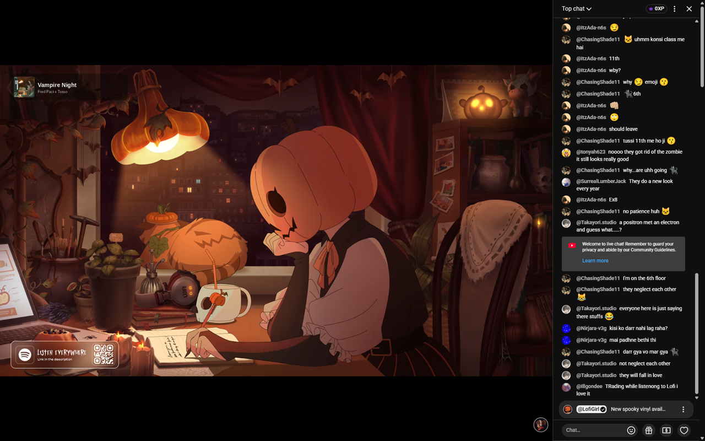

# Absolute Cinema Mode for YouTube

A browser extension that improves YouTube's Cinema mode (the `t` key / theater button) on regular videos, livestreams and livestream replays:

- The player fills the whole window.
- The top bar hides, and slides back when the mouse touches the top edge (it stays open while you're typing in search).
- Live chat and chat replay dock to the right of the video at a width you choose (default 400px). Closing chat gives the video the full width.
- You can still scroll down to the description, comments and recommendations.

Settings are in the toolbar popup: on/off, auto-enable Cinema mode, auto-hide top bar, and chat width (200–800px). Changes apply immediately.

**Auto-enable Cinema mode** (off by default) switches each video into Cinema mode when it opens. If you turn Cinema mode off on a video, it stays off for that video. With the setting off, YouTube's normal behavior applies.

## Install (development)

**Chrome / Edge / Brave**
1. Open `chrome://extensions` and turn on **Developer mode**.
2. Click **Load unpacked** and select this folder.

**Firefox** (140+)
1. Open `about:debugging#/runtime/this-firefox`.
2. Click **Load Temporary Add-on…** and select `manifest.json`.
   Temporary add-ons are removed when Firefox restarts. For a permanent install, the extension has to be signed through addons.mozilla.org.
3. If nothing changes on YouTube, Firefox may not have granted site access yet: go to `about:addons` → the extension → **Permissions** and allow `www.youtube.com`.

## How it works

`src/content.js` watches `<ytd-watch-flexy>` for the `theater` and `live-chat-present-and-expanded` attributes YouTube already sets, and mirrors them as classes on `<html>` (`bcm-theater`, `bcm-chat-open`). All layout changes in `src/content.css` are gated on those classes, so nothing changes outside Cinema mode.

YouTube changes its markup often. If the layout breaks after a YouTube update, the selectors to check are all in `src/content.css`: `#full-bleed-container`, `#panels-full-bleed-container`, `#chat-container`, `ytd-live-chat-frame#chat`, `#columns`, and `#masthead-container`. `src/chat-frame.css` runs inside the chat replay iframe itself.

## Release

- `pwsh scripts/package.ps1` builds the store upload zip in `dist/` (runtime files only).
- `powershell -File scripts/make-store-images.ps1` regenerates `store/screenshot-1.png` (1280×800, from `screenshot.png`) and `store/promo-small.png` (440×280).
- `store/chrome-web-store.md` and `store/firefox-addons.md` have the listing text and privacy answers for each store. The same zip works for both.
- Bump `version` in `manifest.json` before every upload; the store rejects a version it has already seen.

## License

[MIT](LICENSE). Not affiliated with or endorsed by YouTube or Google.
